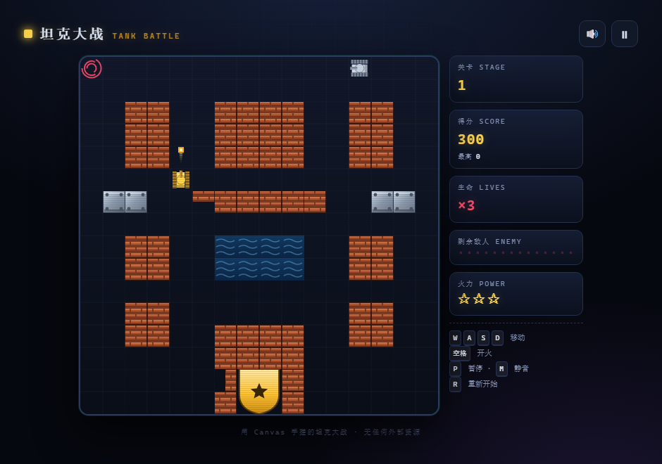

# 坦克大战 · TANK BATTLE

用 HTML5 Canvas 从零手写的坦克大战（Battle City 风格）。
**零依赖、零构建、零外部资源** —— 没有图片、没有音频文件、没有 npm 包，克隆下来双击 `index.html` 就能玩。



<details>
<summary>标题页</summary>


</details>

```
git clone <仓库地址>
cd tank-battle
# 直接双击 index.html，或者：
npx serve .
```

> 也可以直接在 GitHub Pages 上玩：仓库 **Settings → Pages → Source 选 `main` 分支根目录**，几分钟后访问 `https://<用户名>.github.io/<仓库名>/`。

---

## 玩法

守住屏幕底部中央的老鹰基地，消灭全部敌方坦克。基地被击中、或者生命耗尽，游戏结束。

| 操作 | 按键 |
| --- | --- |
| 移动 | `W` `A` `S` `D` 或 `↑` `←` `↓` `→` |
| 开火 | `空格` 或 `J` |
| 暂停 | `P` 或 `Esc` |
| 静音 | `M` |
| 重新开始 | `R` |

触屏设备会自动显示虚拟方向键和开火键。

### 地形

| 图标 | 名称 | 说明 |
| --- | --- | --- |
| 🧱 | 砖墙 | 可摧毁。每格 32px 分成 4 个象限，子弹**逐块啃掉**，能自己打通道 |
| ⬜ | 钢墙 | 打不动，除非火力升到 3 级 |
| 🌊 | 河流 | 坦克过不去，子弹能飞过去 |
| 🌲 | 树林 | 谁都能过，但会**盖住坦克**，适合埋伏 |
| ❄️ | 冰面 | 会打滑，松手之后还会往前溜一段 |
| 🦅 | 基地 | 你的老鹰，被击中立刻结束 |

### 敌人型号

| 型号 | 颜色 | 特点 | 分值 |
| --- | --- | --- | --- |
| 普通 | 灰白 | 标准速度 | 100 |
| 快速 | 青色 | 移动快 1.7 倍 | 200 |
| 火力 | 金色 | 子弹快、可连发两发 | 300 |
| 装甲 | 绿色 | 要打 **4 下**，被打一次变一次颜色 | 400 |

**闪红色的敌人**掉落后会留下补给：

- ★ 火力升级 —— 攒满 3 级后子弹能打穿钢墙
- ✹ 全屏爆破 —— 秒掉场上所有敌人
- ⛨ 无敌护盾 —— 10 秒无敌
- ⛏ 钢铁基地 —— 基地外墙变钢墙，持续 18 秒
- ⛃ 额外生命 —— 生命 +1
- ⏱ 时间冻结 —— 所有敌人停止行动 8 秒

---

## 特性

- **纯手绘画面** —— 坦克、履带、砖块、水波、老鹰全部用 Canvas API 现场画，仓库里一张图片都没有
- **程序合成音效** —— Web Audio 现场合成开炮、爆炸、过关音，同样不带任何音频文件
- **经典手感** —— 换向时自动对齐网格、被挡住时自动"找缝"，在 1 格宽的走廊里也不会卡住
- **8 张手工关卡** —— 打完自动进入二周目，敌人数量和强度递增
- **手机可玩** —— 触屏虚拟摇杆，响应式布局
- **自动测试** —— 附一个 Node 冒烟测试，用假 DOM 把游戏真跑一遍

---

## 项目结构

```
tank-battle/
├── index.html            入口，直接双击就能玩
├── css/
│   └── style.css         街机厅风格样式 + 响应式 + 触屏布局
├── js/
│   ├── audio.js          Web Audio 音效合成器
│   ├── input.js          键盘 / 触屏输入
│   ├── levels.js         8 张关卡地图 + 敌人配置
│   ├── entities.js       坦克 / 子弹 / 爆炸 / 补给 / 基地
│   └── game.js           状态机、主循环、碰撞、地形、渲染
└── tools/
    └── smoke-test.js     Node 冒烟测试
```

脚本用普通 `<script>` 标签按顺序加载（不是 ES module），
所以直接以 `file://` 打开也能跑，不需要起本地服务器。

---

## 测试

```bash
node tools/smoke-test.js   # 或者 npm test
```

测试在 Node 里用一套假的 DOM 和 Canvas 把游戏真正跑起来，覆盖：

- 8 张关卡地图的格式校验（尺寸、合法字符、老鹰数量、出生点通畅）
- 120 秒随机操作对局，检查对象不泄漏、同屏敌人不超上限
- 六种补给逐一验证效果
- 铁锹计时到期后外墙正确变回砖
- 满级子弹能打穿钢板
- 过关 / 基地被毁 / 三条命耗尽 / 最高分读写
- 连续开 30 局的内存压力测试

```
✓ 五个脚本全部载入
✓ 21 项测试全部通过
```

---

## 自己加一关

在 `js/levels.js` 里往 `LEVELS` 数组追加一个对象就行，地图是 16×16 的字符画：

```js
{
  name: '我的关卡',
  nameEn: 'MY STAGE',
  maxOnScreen: 4,
  enemies: { basic: 8, fast: 4, power: 2, armor: 2 },
  map: [
    '................',
    // ... 共 16 行，每行 16 个字符
    '......#EE#......',
    '......#EE#......',
  ],
},
```

字符含义：`.` 空地 / `#` 砖墙 / `@` 钢墙 / `~` 河流 / `T` 树林 / `I` 冰面 / `E` 老鹰。

两个硬性要求：每行必须 16 个字符、老鹰必须正好占 4 格；
另外玩家出生点 `(4,14)` 和三个敌人出生点 `(0,0)` `(7,0)` `(15,0)` 要留空（不然测试会报错）。

---

## 授权

[MIT](LICENSE) —— 随便拿去玩、改、发。
